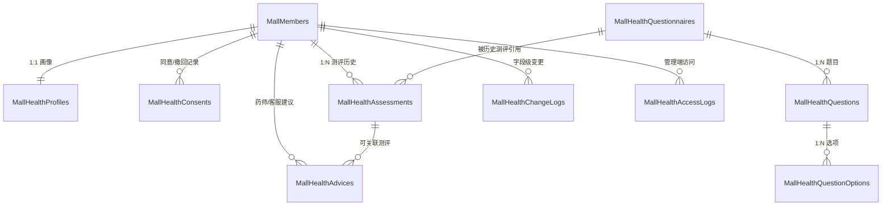

# 会员健康档案 v1 详细设计与建表方案

> 状态：待实施 | 最后核对：2026-11-10 | 对应代码：当前仓库尚无实现，落地后应落在 `web-api/src/QPS.Mall`（实体 `Domain/Entities`、EF 配置 `QPS.Persistence/Configurations`、Handler `Application/Features`）与 `admin/src/views/mall`、`mobile/src/pages`。本文只做设计与建表方案，不修改代码、不建表、不执行迁移；方案确认后再进入实施。

---

## 0. 结论摘要

- 健康档案放在现有 `QPS.Mall` 模块内，沿用商城模块的实体、EF 配置、MediatR Handler、Controller 和 DTO 约定，不新建独立模块。
- 会员基础画像 `MallHealthProfiles` 与体质测评 `MallHealthAssessments` 分表：画像 1:1，可更新；测评 1:N，提交后只增不改，保留历史。
- 体质采用中医九种分类：平和、气虚、阳虚、阴虚、痰湿、湿热、血瘀、气郁、特禀；主体质用 `int` 枚举列，便于后续商品筛选。
- 问卷完全配置化：问卷版本、题目、选项、分值、反向计分、所属体质维度全部入库；不把 60 道题硬编码在代码里。
- 评分算法放在领域服务中，公式为 `(原始分 - 条目数) / (条目数 × 4) × 100`，反向题按 `6 - 原始选项分` 处理。
- 合规基线：单独同意、会员本人读写、药师/客服只读并可追加建议、管理端访问审计、变更日志、敏感数据不进入通用操作日志。
- 商城联动只做设计与接口预留：商品“适宜/慎用体质”标签、孕哺期/过敏史硬提示位置在 v2 落地；v1 不实现推荐算法、不实现个性化商品排序。

---

## 1. 现有项目约定对齐

本方案直接套用现有约定，不另造风格。关键参考如下：

| 约定 | 现有实现 | 本方案落点 |
| --- | --- | --- |
| 实体基类 | [`BaseEntity.cs`](../../web-api/src/QPS.Shared/Common/BaseEntity.cs)：`Guid Id`、`CreatedAt/By`、`UpdatedAt/By`、`IsDeleted`，软删除全局过滤器 | 所有健康实体继承 `BaseEntity` |
| 表命名 | `Mall` + 复数，如 `MallMembers`、`MallOrders` | `MallHealthProfiles`、`MallHealthAssessments` 等 |
| EF 配置 | [`MallModelConfiguration.cs`](../../web-api/src/QPS.Persistence/Configurations/Mall/MallModelConfiguration.cs)：`ToTable`、`HasMaxLength`、`HasIndex(...).HasFilter("[IsDeleted] = 0")`、枚举存 `int` | 在 `MallModelConfiguration.Apply` 内追加配置 |
| DbContext | [`AppDbContext.cs`](../../web-api/src/QPS.Persistence/Database/AppDbContext.cs)：单一 `AppDbContext`，实现 `IMallDbContext`，自动审计与操作日志 | 新增 `DbSet`，同步在 [`IMallDbContext.cs`](../../web-api/src/QPS.Mall/Contracts/IMallDbContext.cs) 增加属性 |
| 迁移 | `QPS.Persistence/Migrations`，EF Core 8.0.8；部分迁移手写并附回填/权限 SQL | 新增 `AddMallHealthProfiles` 迁移，权限种子 SQL 沿用既有写法 |
| Controller | 移动端 `[Route("api/mall")] [Authorize(Policy = "MallMember")]`；管理端 `api/admin/mall/...`，返回 `Ok(await _mediator.Send(...))` | 新增移动端 `MallHealthController`、管理端 `MallHealthQuestionnaireController` / `MallHealthMemberController` |
| Handler | `Application/Features/{功能}`，MediatR；一个用例一个文件，复杂规则下沉到 `Rules` / `Mapper` / 领域服务 | `Features/MallHealthProfiles`、`Features/MallHealthAssessments`、`Features/MallHealthQuestionnaires`、`Features/MallHealthAdmin` |
| DTO | 跨功能共享 DTO 放 `Contracts/DTOs`；会员相关已有 `Contracts/DTOs/MallMembers` | 健康 DTO 放 `Contracts/DTOs/MallHealth`，按画像/测评/问卷/管理端分组 |
| 权限 | `[Permission(MallPermissionCodes.XXX)]` + `PermissionBehaviour`；权限码常量名与字符串一致 | 新增 `QPS.Mall.Contracts.Permissions.MallPermissionCodes` |
| 移动端入口 | [`profile/index.vue`](../../mobile/src/pages/profile/index.vue)：`goService('archive')` 仍走 toast；顶部体质文案写死“气虚夹湿型” | v1 改为跳转健康档案页，并读取最近一次测评结果；删除写死文案 |
| 管理端结构 | `admin/src/views/mall/*`、`admin/src/api/modules/mall*.ts`、`admin/src/assets/json/authMenuList.json` | 新增 `views/mall/health/*`、`api/modules/mallHealth.ts` 和菜单项 |

> 说明：移动端已通过 `VITE_API_BASE_URL` 调用真实后端（如 `/api/mall/member/me`），健康档案按同一请求层接入，不新增独立 mock。

### 1.1 EF 配置与 DbContext 示意（仅示意，不落地）

以下写法与现有 `MallModelConfiguration.Apply` 一致，仅展示关键配置方式；全部 9 张表按同样风格补充：

```csharp
// QPS.Persistence/Configurations/Mall/MallModelConfiguration.cs
modelBuilder.Entity<MallHealthProfile>(entity =>
{
    entity.ToTable("MallHealthProfiles");
    entity.Property(p => p.Gender).HasDefaultValue(MallHealthGender.Unknown);
    entity.Property(p => p.PregnancyStatus).HasDefaultValue(MallPregnancyStatus.Unknown);
    entity.Property(p => p.HeightCm).HasPrecision(5, 1);
    entity.Property(p => p.WeightKg).HasPrecision(5, 1);
    entity.Property(p => p.AllergyHistory).HasMaxLength(1000);
    entity.Property(p => p.MedicalHistory).HasMaxLength(1000);
    entity.Property(p => p.CurrentMedications).HasMaxLength(1000);
    entity.Property(p => p.LifestyleNotes).HasMaxLength(1000);

    entity.HasIndex(p => p.MemberId)
          .IsUnique()
          .HasFilter("[IsDeleted] = 0");

    entity.HasOne<MallMember>()
          .WithMany()
          .HasForeignKey(p => p.MemberId)
          .OnDelete(DeleteBehavior.Restrict);
});

modelBuilder.Entity<MallHealthAssessment>(entity =>
{
    entity.ToTable("MallHealthAssessments", t =>
        t.HasCheckConstraint("CK_MallHealthAssessments_Status", "[Status] IN (0, 1)"));
    entity.Property(a => a.QuestionnaireVersion).HasMaxLength(50);
    entity.Property(a => a.SecondaryConstitutionsJson).HasDefaultValue("[]");
    entity.Property(a => a.TendencyConstitutionsJson).HasDefaultValue("[]");
    entity.Property(a => a.ScoresJson).HasDefaultValue("{}");
    entity.Property(a => a.AnswersJson).HasDefaultValue("{\"answers\":[]}");

    entity.HasIndex(a => new { a.MemberId, a.Status, a.AssessedAt })
          .IsDescending(false, false, true);
    entity.HasIndex(a => new { a.MainConstitution, a.Status });
});
```

`AppDbContext` 与 `IMallDbContext` 同步增加：

```csharp
// IMallDbContext
DbSet<MallHealthProfile> MallHealthProfiles { get; }
DbSet<MallHealthAssessment> MallHealthAssessments { get; }
DbSet<MallHealthQuestionnaire> MallHealthQuestionnaires { get; }
DbSet<MallHealthQuestion> MallHealthQuestions { get; }
DbSet<MallHealthQuestionOption> MallHealthQuestionOptions { get; }
DbSet<MallHealthConsent> MallHealthConsents { get; }
DbSet<MallHealthAdvice> MallHealthAdvices { get; }
DbSet<MallHealthChangeLog> MallHealthChangeLogs { get; }
DbSet<MallHealthAccessLog> MallHealthAccessLogs { get; }
```

DTO 建议文件：

- `QPS.Mall.Contracts/DTOs/MallHealth/MallHealthProfileDtos.cs`
- `QPS.Mall.Contracts/DTOs/MallHealth/MallHealthAssessmentDtos.cs`
- `QPS.Mall.Contracts/DTOs/MallHealth/MallHealthQuestionnaireDtos.cs`
- `QPS.Mall.Contracts/DTOs/MallHealth/MallHealthAdminDtos.cs`

---

## 2. 设计原则与边界

### 2.1 设计原则

1. **画像与测评分离**：画像只保存相对稳定的健康属性；体质结论只存在于测评记录，画像表不冗余 `CurrentConstitution`，避免历史结论被覆盖。
2. **测评只增不改**：已提交测评不允许修改答案、分数、主体质；需要修正时新增一条测评并注明来源，历史全部保留。
3. **问卷版本不可变**：已发布问卷的题目、选项、分值、反向标记不可编辑；修改必须新建草稿版本，发布后旧版本自动归档。
4. **服务端计分**：客户端只提交 `questionId + optionId`，不提交分值；分值、反向计分、判定全部在服务端完成，防止篡改。
5. **最小必要**：不采集身份证号、基因、人脸、金融等无关信息；健康文本只采集调养所需内容。
6. **可审计**：会员健康数据的字段级变更写专用变更日志；管理端读取写访问审计日志；通用 `SystemOperationLogs` 不承载健康明文。

### 2.2 v1 明确边界

v1 做：

- 健康画像的查询与保存；
- 单独同意与撤回；
- 问卷配置、发布、归档；
- 体质测评草稿、提交、历史、结果；
- 药师/客服查看会员健康档案、录入测评、追加建议；
- 变更日志与访问审计。

v1 不做：

- 商品“适宜体质/慎用体质”标签与筛选；
- 基于体质的个性化推荐、排序、营销触达；
- 孕哺期/过敏史的个性化商品匹配（仅在商品详情和结算页预留提示位置，展示通用提示）；
- 问卷题目在代码中硬编码；
- 测评结果导出、PDF、报告分享；
- 多量表（除中医体质外的其他量表）；
- 数据脱敏导出、字段级加密、自动保留期清理；
- AI 生成建议、自动诊断、处方或用药推荐。

---

## 3. 数据模型

### 3.1 实体关系图



说明：

- `MallMembers` 是现有表，只做外键引用，不修改其结构。
- 主体质不放进 `MallHealthProfiles`，由“最近一次已提交测评”派生。
- `MallHealthChangeLogs`、`MallHealthAccessLogs` 是审计表，不做成员外键，避免成员清理/归档时阻塞审计数据保留。

### 3.2 枚举定义

所有枚举在实体中声明为 C# `enum`，EF 默认映射为 SQL Server `int`；DTO 对外同时给出 `int` 值和中文名称。

| 枚举 | 取值 | 说明 |
| --- | --- | --- |
| `MallConstitutionType` | `0` 未判定；`1` 平和；`2` 气虚；`3` 阳虚；`4` 阴虚；`5` 痰湿；`6` 湿热；`7` 血瘀；`8` 气郁；`9` 特禀 | 主体质、兼夹、倾向、题目维度共用 |
| `MallHealthQuestionnaireStatus` | `0` 草稿；`1` 已发布；`2` 已归档 | 同一 `ScaleCode` 同时只能有一个已发布版本 |
| `MallHealthAssessmentStatus` | `0` 草稿；`1` 已提交 | 提交后不可修改 |
| `MallHealthAssessmentSource` | `1` 自测；`2` 药师录入 | 药师录入由管理端发起 |
| `MallHealthConsentType` | `1` 健康数据处理同意 | v1 只有一种 |
| `MallHealthConsentAction` | `1` 同意；`2` 撤回 | 追加记录，不覆盖历史 |
| `MallHealthOperatorType` | `1` 会员；`2` 药师/客服；`3` 管理员；`4` 系统 | 变更日志操作者类型 |
| `MallHealthChangeType` | `1` 新建；`2` 修改；`3` 删除；`4` 撤回 | 变更日志动作 |
| `MallHealthAdviceCategory` | `1` 生活方式；`2` 饮食调养；`3` 复测提醒；`4` 就医提醒 | 不提供处方/用药建议分类 |
| `MallHealthAccessAction` | `1` 查看档案；`2` 查看测评；`3` 导出 | v1 只使用 1、2 |
| `MallHealthGender` | `0` 未填；`1` 男；`2` 女 | 画像内使用 |
| `MallPregnancyStatus` | `0` 未填；`1` 无；`2` 备孕；`3` 孕期；`4` 哺乳期 | 孕哺期硬提示的数据基础 |
| `MallHealthProfileDataSource` | `1` 本人填写；`2` 药师协助 | 画像来源 |
| `MallHealthQuestionType` | `1` 单选 | v1 固定单选 |
| `MallProductConstitutionSuitability` | `1` 适宜；`2` 慎用；`3` 禁忌 | v2 商品标签预留，不在 v1 迁移中建表 |

### 3.3 公共审计字段

以下所有表都包含 `BaseEntity` 的公共字段：

| 字段 | 类型 | 可空 | 默认值 | 说明 |
| --- | --- | --- | --- | --- |
| `Id` | `uniqueidentifier` | 否 | 无（`BaseEntity` 构造生成） | 主键 |
| `CreatedAt` | `datetime2` | 否 | 无（`SaveChanges` 写入） | 创建时间 |
| `CreatedBy` | `nvarchar(max)` | 否 | 无（`SaveChanges` 写入） | 创建人 |
| `UpdatedAt` | `datetime2` | 否 | 无（`SaveChanges` 写入） | 更新时间 |
| `UpdatedBy` | `nvarchar(max)` | 否 | 无（`SaveChanges` 写入） | 更新人 |
| `IsDeleted` | `bit` | 否 | 无（应用层写入 `false`） | 软删除标记 |

> 说明：`CreatedBy/UpdatedBy` 与现有 `BaseEntity` 一致使用 `nvarchar(max)`；不额外改成固定长度，避免与 EF 模型快照不一致。

### 3.4 表结构

v1 共 9 张表：1 张同意记录、1 张画像、3 张问卷配置（问卷版本、题目、选项）、1 张测评记录、1 张建议、2 张审计日志。全部落在 `QPS.Mall` 模块，表名前缀 `MallHealth`。

### 3.4.1 `MallHealthConsents` 健康数据同意记录

追加式记录：每次同意、撤回都新增一行，不覆盖历史。

| 字段 | 类型 | 可空 | 默认值 | 说明 |
| --- | --- | --- | --- | --- |
| `MemberId` | `uniqueidentifier` | 否 | 无 | 会员，外键到 `MallMembers` |
| `ConsentType` | `int` | 否 | `1` | `1` 健康数据处理同意 |
| `PolicyVersion` | `nvarchar(50)` | 否 | 无 | 同意的政策/说明版本，例如 `2026.11` |
| `PolicyTextHash` | `nvarchar(64)` | 否 | 无 | 服务端保存的政策文本 SHA-256，证明同意的是哪一版文本 |
| `Action` | `int` | 否 | `1` | `1` 同意；`2` 撤回 |
| `OccurredAt` | `datetime2` | 否 | 无 | 同意/撤回发生时间 |
| `IpAddress` | `nvarchar(64)` | 否 | `''` | 请求 IP |
| `UserAgent` | `nvarchar(500)` | 否 | `''` | 客户端标识，便于合规举证 |

索引/外键：

- 普通索引：`(MemberId, ConsentType, OccurredAt DESC)`。
- 外键：`MemberId -> MallMembers.Id`，`ON DELETE NO ACTION`。
- 无唯一约束，允许同一会员多次同意/撤回。

当前是否已同意：取该会员该 `ConsentType` 最新一条 `Action`，`1` 表示有效，`2` 表示已撤回。

### 3.4.2 `MallHealthProfiles` 会员健康画像

1:1 画像，`MemberId` 唯一。画像只保存稳定属性；主体质从最近一次已提交测评派生。

| 字段 | 类型 | 可空 | 默认值 | 说明 |
| --- | --- | --- | --- | --- |
| `MemberId` | `uniqueidentifier` | 否 | 无 | 会员，外键到 `MallMembers` |
| `Gender` | `int` | 否 | `0` | `0` 未填；`1` 男；`2` 女 |
| `BirthDate` | `datetime2` | 是 | 无 | 出生日期，时间部分为 `00:00:00` |
| `HeightCm` | `decimal(5,1)` | 是 | 无 | 身高厘米，建议范围 50–250 |
| `WeightKg` | `decimal(5,1)` | 是 | 无 | 体重千克，建议范围 10–300 |
| `PregnancyStatus` | `int` | 否 | `0` | `0` 未填；`1` 无；`2` 备孕；`3` 孕期；`4` 哺乳期 |
| `HasAllergyHistory` | `bit` | 是 | 无 | `NULL` 未填；`0` 无；`1` 有 |
| `AllergyHistory` | `nvarchar(1000)` | 是 | 无 | 过敏史文本，`HasAllergyHistory = 1` 时必填 |
| `MedicalHistory` | `nvarchar(1000)` | 是 | 无 | 既往病史文本 |
| `CurrentMedications` | `nvarchar(1000)` | 是 | 无 | 正在服用的药物文本 |
| `LifestyleNotes` | `nvarchar(1000)` | 是 | 无 | 饮食、作息、运动等补充 |
| `DataSource` | `int` | 否 | `1` | `1` 本人填写；`2` 药师协助 |
| `LastConfirmedAt` | `datetime2` | 是 | 无 | 会员最近一次确认画像的时间 |

索引/外键：

- 唯一索引：`(MemberId) WHERE [IsDeleted] = 0`，保证未删除记录中一人一份画像。
- 外键：`MemberId -> MallMembers.Id`，`ON DELETE NO ACTION`。
- 不建立 `CurrentConstitution` 字段；需要主体质时查询最新已提交测评。

### 3.4.3 `MallHealthQuestionnaires` 问卷版本

| 字段 | 类型 | 可空 | 默认值 | 说明 |
| --- | --- | --- | --- | --- |
| `ScaleCode` | `nvarchar(50)` | 否 | 无 | 量表编码，v1 固定 `TCM_CONSTITUTION` |
| `Version` | `nvarchar(50)` | 否 | 无 | 问卷版本，例如 `2026.11` |
| `Name` | `nvarchar(100)` | 否 | 无 | 问卷名称，例如“中医体质分类与判定问卷” |
| `Status` | `int` | 否 | `0` | `0` 草稿；`1` 已发布；`2` 已归档 |
| `SourceName` | `nvarchar(200)` | 否 | `''` | 题目来源/标准名称 |
| `CopyrightNotice` | `nvarchar(500)` | 否 | `''` | 版权/授权说明 |
| `Disclaimer` | `nvarchar(500)` | 否 | `''` | 测评免责声明，随版本固化 |
| `Remark` | `nvarchar(500)` | 是 | 无 | 内部备注 |
| `PublishedAt` | `datetime2` | 是 | 无 | 发布时间 |
| `ArchivedAt` | `datetime2` | 是 | 无 | 归档时间 |

索引/外键：

- 唯一索引：`(ScaleCode, Version) WHERE [IsDeleted] = 0`。
- 唯一筛选索引：`(ScaleCode) WHERE [Status] = 1 AND [IsDeleted] = 0`，保证同一量表只有一个已发布版本。
- 普通索引：`(Status)`。

版本规则：

- 草稿可编辑；
- 已发布不可编辑；
- 发布新版本时，旧已发布版本自动改为已归档；
- 已归档版本仍可被历史测评引用；
- 已有测评引用的问卷不物理删除，只能归档。

### 3.4.4 `MallHealthQuestions` 题目

| 字段 | 类型 | 可空 | 默认值 | 说明 |
| --- | --- | --- | --- | --- |
| `QuestionnaireId` | `uniqueidentifier` | 否 | 无 | 所属问卷 |
| `Code` | `nvarchar(20)` | 否 | 无 | 题号，例如 `Q001` |
| `ConstitutionType` | `int` | 否 | 无 | 所属体质维度：`1`–`9` |
| `Content` | `nvarchar(200)` | 否 | 无 | 题干 |
| `HelpText` | `nvarchar(200)` | 否 | `''` | 辅助说明 |
| `QuestionType` | `int` | 否 | `1` | `1` 单选 |
| `IsReverseScored` | `bit` | 否 | `0` | 是否反向计分 |
| `IsRequired` | `bit` | 否 | `1` | 是否必答；v1 中医体质量表全部必答 |
| `SortOrder` | `int` | 否 | 无 | 展示顺序 |

索引/外键：

- 唯一索引：`(QuestionnaireId, Code) WHERE [IsDeleted] = 0`。
- 普通索引：`(QuestionnaireId, ConstitutionType)`。
- 普通索引：`(QuestionnaireId, SortOrder)`。
- 外键：`QuestionnaireId -> MallHealthQuestionnaires.Id`，`ON DELETE CASCADE`（仅物理清理草稿问卷时使用；业务上优先归档/软删除）。

### 3.4.5 `MallHealthQuestionOptions` 选项

| 字段 | 类型 | 可空 | 默认值 | 说明 |
| --- | --- | --- | --- | --- |
| `QuestionId` | `uniqueidentifier` | 否 | 无 | 所属题目 |
| `Code` | `nvarchar(10)` | 否 | 无 | 选项编码，例如 `A`–`E` |
| `Content` | `nvarchar(100)` | 否 | 无 | 选项文案 |
| `Score` | `int` | 否 | 无 | 原始分值，v1 固定 `1`–`5` |
| `SortOrder` | `int` | 否 | 无 | 展示顺序 |

索引/约束/外键：

- 唯一索引：`(QuestionId, Code) WHERE [IsDeleted] = 0`。
- 普通索引：`(QuestionId, SortOrder)`。
- 检查约束：`Score BETWEEN 1 AND 5`。
- 外键：`QuestionId -> MallHealthQuestions.Id`，`ON DELETE CASCADE`。

### 3.4.6 `MallHealthAssessments` 体质测评记录

1:N，追加式；草稿可更新，提交后不可更新。

| 字段 | 类型 | 可空 | 默认值 | 说明 |
| --- | --- | --- | --- | --- |
| `MemberId` | `uniqueidentifier` | 否 | 无 | 会员 |
| `QuestionnaireId` | `uniqueidentifier` | 否 | 无 | 作答时使用的问卷版本 |
| `QuestionnaireVersion` | `nvarchar(50)` | 否 | 无 | 问卷版本快照，防止问卷表变动影响历史解释 |
| `Status` | `int` | 否 | `0` | `0` 草稿；`1` 已提交 |
| `Source` | `int` | 否 | `1` | `1` 自测；`2` 药师录入 |
| `AssessedAt` | `datetime2` | 否 | 无 | 测评业务时间；草稿为创建时间，提交后不覆盖 |
| `SubmittedAt` | `datetime2` | 是 | 无 | 提交时间；草稿为空 |
| `MainConstitution` | `int` | 是 | 无 | 主体质：`0` 未判定；`1`–`9` 九种体质；草稿为空 |
| `SecondaryConstitutionsJson` | `nvarchar(max)` | 否 | `'[]'` | 兼夹体质集合，`int[]` |
| `TendencyConstitutionsJson` | `nvarchar(max)` | 否 | `'[]'` | 倾向体质集合，`int[]` |
| `ScoresJson` | `nvarchar(max)` | 否 | `'{}'` | 九项分数与判定明细，结构见 3.5 |
| `AnswersJson` | `nvarchar(max)` | 否 | `'{"answers":[]}'` | 原始答案 JSON，结构见 3.5 |
| `AnsweredCount` | `int` | 否 | `0` | 已答题数快照 |
| `QuestionCount` | `int` | 否 | `0` | 问卷题目总数快照 |
| `Remark` | `nvarchar(500)` | 否 | `''` | 备注；药师录入时可填 |

索引/外键：

- 普通索引：`(MemberId, Status, AssessedAt DESC)`，支持“我的测评历史”和“最近一次已提交”。
- 普通索引：`(QuestionnaireId)`。
- 普通索引：`(MainConstitution, Status)`，为 v2 商品按主体质筛选预留。
- 外键：`MemberId -> MallMembers.Id`，`ON DELETE NO ACTION`。
- 外键：`QuestionnaireId -> MallHealthQuestionnaires.Id`，`ON DELETE NO ACTION`，保证历史测评不被问卷删除连带清理。
- 检查约束：`Status IN (0, 1)`；`MainConstitution IS NULL OR MainConstitution BETWEEN 0 AND 9`。

只增不改规则：

- 草稿允许保存答案、修改答案；
- 提交时一次性校验、计分、写结果；
- 已提交记录不提供修改/删除接口；
- 重复提交同一草稿：幂等返回已提交结果，不重复计分；
- 修正历史结论只能新增测评，不能覆盖旧记录。

### 3.4.7 `MallHealthAdvices` 药师/客服建议

追加式记录，不提供修改/删除接口；修正建议以新增记录表达。

| 字段 | 类型 | 可空 | 默认值 | 说明 |
| --- | --- | --- | --- | --- |
| `MemberId` | `uniqueidentifier` | 否 | 无 | 会员 |
| `AssessmentId` | `uniqueidentifier` | 是 | 无 | 关联测评；可为空，表示与具体测评无关的通用建议 |
| `Category` | `int` | 否 | `1` | `1` 生活方式；`2` 饮食调养；`3` 复测提醒；`4` 就医提醒 |
| `Content` | `nvarchar(1000)` | 否 | 无 | 建议内容 |
| `AdvisorUserId` | `uniqueidentifier` | 否 | 无 | 药师/客服系统用户 ID |
| `AdvisorName` | `nvarchar(100)` | 否 | 无 | 操作者姓名快照 |
| `AdvisorRoleCode` | `nvarchar(64)` | 否 | 无 | 操作角色编码快照 |
| `IsVisibleToMember` | `bit` | 否 | `1` | 是否对会员可见 |

索引/外键：

- 普通索引：`(MemberId, CreatedAt DESC)`。
- 普通索引：`(AssessmentId)`。
- 外键：`MemberId -> MallMembers.Id`，`ON DELETE NO ACTION`。
- 外键：`AssessmentId -> MallHealthAssessments.Id`，`ON DELETE NO ACTION`。

内容约束：

- 建议只能是调养、复测、就医提醒类内容；
- 不允许出现“诊断”“治愈”“疗效”“处方”“替代药物”等表述；
- 不提供药品剂量、处方组合、停药/换药指令；
- v1 采用人工审核，不做自动内容判定；如需，可在后续增加敏感词提示，但不能替代人工审核。

### 3.4.8 `MallHealthChangeLogs` 健康档案变更日志

记录“谁、何时、改了哪个字段、改前改后”。由 Handler 在业务事务内显式写入。

| 字段 | 类型 | 可空 | 默认值 | 说明 |
| --- | --- | --- | --- | --- |
| `MemberId` | `uniqueidentifier` | 否 | 无 | 被变更档案所属会员 |
| `EntityType` | `nvarchar(32)` | 否 | 无 | `Profile`、`Assessment`、`Advice`、`Consent` |
| `EntityId` | `uniqueidentifier` | 否 | 无 | 被变更记录 ID |
| `ChangeType` | `int` | 否 | 无 | `1` 新建；`2` 修改；`3` 删除；`4` 撤回 |
| `FieldName` | `nvarchar(64)` | 否 | 无 | 字段名或逻辑字段名 |
| `OldValue` | `nvarchar(max)` | 是 | 无 | 改前值；新建时为空 |
| `NewValue` | `nvarchar(max)` | 是 | 无 | 改后值；删除/撤回时为空 |
| `OperatorType` | `int` | 否 | 无 | `1` 会员；`2` 药师/客服；`3` 管理员；`4` 系统 |
| `OperatorUserId` | `uniqueidentifier` | 是 | 无 | 系统用户或会员 ID；系统操作可为空 |
| `OperatorName` | `nvarchar(100)` | 否 | `''` | 操作者名称快照 |
| `OperatorRoleCode` | `nvarchar(64)` | 否 | `''` | 操作角色编码快照 |
| `IpAddress` | `nvarchar(64)` | 否 | `''` | 请求 IP |

索引：

- 普通索引：`(MemberId, CreatedAt DESC)`。
- 普通索引：`(EntityType, EntityId)`。
- 无成员外键：审计数据独立保留。

写入规则：

- 画像保存：逐字段比较，只有真正变化的字段写一行；文本字段保存改前/改后全文。
- 测评草稿：新建时写一行 `Status = 草稿`；草稿答案变更只记录 `AnsweredCount` 变化，不记录每次答案明文。
- 测评提交：记录 `Status`、`MainConstitution`、`SecondaryConstitutionsJson`、`TendencyConstitutionsJson`、`ScoresJson` 的摘要，以及 `AnswersJson` 的 `题目数 + SHA-256`，避免在日志中重复保存整套原始答案。
- 建议：新建时记录 `Category` 与 `Content`；后续不修改。
- 同意/撤回：记录 `Action` 与 `PolicyVersion`。
- 问卷配置变更：属于配置数据，不进会员健康变更日志，仍由通用 `SystemOperationLogs` 记录。

### 3.4.9 `MallHealthAccessLogs` 管理端访问审计

记录药师/客服/管理员对会员健康数据的读取行为。

| 字段 | 类型 | 可空 | 默认值 | 说明 |
| --- | --- | --- | --- | --- |
| `MemberId` | `uniqueidentifier` | 否 | 无 | 被访问会员 |
| `AssessmentId` | `uniqueidentifier` | 是 | 无 | 被查看的具体测评；查看档案摘要时为空 |
| `AccessAction` | `int` | 否 | 无 | `1` 查看档案；`2` 查看测评；`3` 导出 |
| `AccessReason` | `nvarchar(200)` | 否 | `''` | 访问事由；查看测评详情时建议必填 |
| `OperatorUserId` | `uniqueidentifier` | 否 | 无 | 访问者系统用户 ID |
| `OperatorName` | `nvarchar(100)` | 否 | 无 | 访问者姓名快照 |
| `OperatorRoleCode` | `nvarchar(64)` | 否 | 无 | 访问者角色编码快照 |
| `IpAddress` | `nvarchar(64)` | 否 | `''` | 请求 IP |
| `UserAgent` | `nvarchar(500)` | 否 | `''` | 客户端标识 |

索引：

- 普通索引：`(MemberId, CreatedAt DESC)`。
- 普通索引：`(OperatorUserId, CreatedAt DESC)`。
- 无成员外键。

写入规则：

- 管理端每次读取会员画像、测评列表、测评详情都写一条；
- 会员本人读取自己的健康数据不写访问日志，避免噪声；
- 导出功能不在 v1，`AccessAction = 3` 仅预留；
- 访问日志与读取操作同一事务写入，读接口也要开启事务或至少保证写日志失败时返回错误。

### 3.5 JSON 结构

三处 JSON 列统一带 `schemaVersion`，读取时按版本兼容解析，不做就地改写。

### 3.5.1 `ScoresJson`

```json
{
  "schemaVersion": 1,
  "scores": {
    "PINGHE":  { "raw": 18, "converted": 45.00, "measured": true,  "judgement": "TENDENCY" },
    "QIXU":    { "raw": 22, "converted": 62.50, "measured": true,  "judgement": "MAIN" },
    "YANGXU":  { "raw": 17, "converted": 41.67, "measured": true,  "judgement": "SECONDARY" },
    "YINXU":   { "raw": 12, "converted": 20.00, "measured": true,  "judgement": "NONE" },
    "TANSHI":  { "raw": 15, "converted": 31.25, "measured": true,  "judgement": "TENDENCY" },
    "SHIRE":   { "raw": 10, "converted": 8.33,  "measured": true,  "judgement": "NONE" },
    "XUEYU":   { "raw": 11, "converted": 12.50, "measured": true,  "judgement": "NONE" },
    "QIYU":    { "raw": 13, "converted": 25.00, "measured": true,  "judgement": "NONE" },
    "TEBI":    { "raw": 0,  "converted": null,  "measured": false, "judgement": "UNMEASURED" }
  }
}
```

- `raw`：有效原始分（反向题已转换）。
- `converted`：转化分，保留 2 位小数；未测量为 `null`。
- `measured`：该维度是否有题目。
- `judgement`：`MAIN`、`SECONDARY`、`TENDENCY`、`NONE`、`UNMEASURED`、`PINGHE`。

### 3.5.2 `SecondaryConstitutionsJson` / `TendencyConstitutionsJson`

```json
[2, 5]
```

只存 `MallConstitutionType` 的 `int` 值，顺序按分数从高到低，同分按枚举顺序。

### 3.5.3 `AnswersJson`

```json
{
  "schemaVersion": 1,
  "questionnaireId": "6d0f7c0e-...",
  "questionnaireVersion": "2026.11",
  "answers": [
    {
      "questionId": "8a1b...",
      "questionCode": "Q001",
      "optionId": "c2d3...",
      "optionCode": "A",
      "rawScore": 4,
      "effectiveScore": 4
    }
  ]
}
```

- 客户端只提交 `questionId`、`optionId`；`rawScore`、`effectiveScore` 由服务端计算后写入。
- 反向题：`effectiveScore = 6 - rawScore`。
- 问卷版本发布后不可变，因此答案只存 ID 也能还原题目和选项语义。

### 3.6 问卷版本与不可变规则

1. 新建问卷必须是草稿状态，可反复保存题目树。
2. 发布前校验：
   - 至少一个题目；
   - 量表为 `TCM_CONSTITUTION` 时，九个体质维度都必须至少有一题；
   - 每题至少 2 个选项，分值互不重复且在 `1`–`5`；
   - 题号在问卷内唯一，选项编码在题目内唯一；
   - 所有 `TCM_CONSTITUTION` 题目 `IsRequired = true`。
3. 发布时在同一事务内：
   - 将同 `ScaleCode` 当前已发布版本改为 `Archived`，写 `ArchivedAt`；
   - 当前版本改为 `Published`，写 `PublishedAt`。
4. 已发布/已归档问卷的题目、选项、分值、反向标记禁止编辑。
5. 已有测评引用的问卷不能物理删除；草稿可以软删除，已发布/已归档只能归档。
6. 新版本发布后，旧草稿不自动迁移；用户需要重新作答新版本。

### 3.7 测评草稿与提交规则

- 草稿绑定 `QuestionnaireId`，并使用该问卷的 `Version` 快照。
- 同一会员、同一问卷版本最多保留一个进行中的草稿；再次创建草稿时返回已有草稿。
- 草稿允许部分作答、反复保存。
- 提交时必须：
  - 草稿属于当前会员；
  - 草稿状态为 `Draft`；
  - 问卷状态不是 `Draft`（可以是 `Published` 或 `Archived`）；
  - 所有必答题已作答；
  - 每个答案的选项属于对应题目；
  - 会员存在有效同意记录（药师录入同样要求会员已同意）。
- 提交后写入 `SubmittedAt`、`Status = Submitted`、主体质、兼夹、倾向、分数、原始答案。
- 提交后不提供修改/删除接口；重复提交幂等返回已有结果。
- 新版本发布后，旧版本草稿仍可提交，但响应标记 `questionnaireOutdated = true`，前端提示“已有新版本，可重新测评”。

### 3.8 审计与通用操作日志的关系

现有 [`AppDbContext.cs`](../../web-api/src/QPS.Persistence/Database/AppDbContext.cs) 的 `AddOperationLogs()` 会对所有 `BaseEntity` 的增删改写 `SystemOperationLogs`，并把字段改前/改后完整写入 `ChangeJson`。这会把健康明文复制到通用操作日志，存在两个问题：

1. 通用操作日志的查看权限与健康档案权限不一致，可能扩大健康数据可见范围；
2. 同一份答案/病史会被重复保存，增加泄露面和存储成本。

建议在实施时做一个**需要确认的共享层小改动**：

- 在 `AppDbContext.AddOperationLogs()` 中排除会员健康数据实体（`MallHealthProfile`、`MallHealthAssessment`、`MallHealthConsent`、`MallHealthAdvice`、`MallHealthChangeLog`、`MallHealthAccessLog`）；
- 这些实体由 `MallHealthChangeLogs` / `MallHealthAccessLogs` 专用审计表覆盖；
- 问卷配置实体（`MallHealthQuestionnaire`、`MallHealthQuestion`、`MallHealthQuestionOption`）不属于会员敏感数据，可继续走通用操作日志。

该改动触及 `AppDbContext` 公共基础设施，按工作区规则必须先向负责人确认后再实施。

---

## 4. 评分算法

### 4.1 输入与输出

输入：

- 问卷版本 `questionnaire`（含题目、维度、反向标记、选项分值）；
- 答案集合 `answers`：`questionId -> optionId`；
- 会员、来源、测评时间由 Handler 提供。

输出：

- 九项 `raw`、`converted`、`measured`；
- 主体质 `mainConstitution`（`0` 表示未判定）；
- 兼夹体质集合 `secondaryConstitutions`；
- 倾向体质集合 `tendencyConstitutions`；
- 每题的有效分与原始分，写入 `AnswersJson`。

### 4.2 计分伪代码

```text
FUNCTION ScoreAssessment(questionnaire, answers):
    ASSERT questionnaire.Status != Draft
    questions = questionnaire.Questions where IsDeleted = false

    // 1. 必答校验
    requiredQuestions = questions where IsRequired = true
    missing = requiredQuestions where answers does not contain question.Id
    IF missing is not empty:
        ERROR 400 "还有 {missing.Count} 题未作答"
              WITH missingQuestionCodes = missing.Select(Code)

    // 2. 答案合法性校验：题目存在、选项属于该题、题目必答
    FOR EACH (questionId, optionId) IN answers:
        question = questions.Find(questionId)
        IF question is null:
            ERROR 400 "答案包含未知题目"
        option = question.Options.Find(optionId)
        IF option is null:
            ERROR 400 "选项不属于对应题目"

    // 3. 逐维度计算
    resultScores = {}
    FOR type IN 1..9:
        items = questions where ConstitutionType = type
        n = items.Count

        IF n = 0:
            resultScores[type] = {
                raw: 0,
                converted: null,
                measured: false,
                judgement: "UNMEASURED"
            }
            CONTINUE

        rawSum = 0
        FOR EACH question IN items:
            option = answers[question.Id].Option
            score = option.Score                 // 1..5
            IF question.IsReverseScored:
                effective = 6 - score             // 反向计分
            ELSE:
                effective = score
            rawSum = rawSum + effective

        // 公式：转化分 = (原始分 - 条目数) / (条目数 × 4) × 100
        converted = (rawSum - n) / (n * 4) * 100
        converted = CLAMP(converted, 0, 100)      // 防御性边界
        resultScores[type] = {
            raw: rawSum,
            converted: converted,                 // 保留 2 位小数用于存储/展示
            measured: true,
            judgement: "NONE"
        }

    // 4. 平和质单独判定
    pinghe = resultScores[PINGHE].converted
    biasedTypes = 2..9 where resultScores[type].measured = true
    allBiasedBelow40 = ALL(type IN biasedTypes:
                          resultScores[type].converted < 40)

    IF pinghe is not null AND pinghe >= 60 AND allBiasedBelow40:
        main = PINGHE
        secondary = []
        tendency = biasedTypes where 30 <= converted < 40
        mark main as "PINGHE"
        mark tendency as "TENDENCY"
        RETURN result(main, secondary, tendency, resultScores)

    // 5. 偏颇体质判定
    biasedCandidates = biasedTypes where converted >= 40

    IF biasedCandidates is empty:
        main = UNDETERMINED (0)
        secondary = []
        tendency = biasedTypes where 30 <= converted < 40
        RETURN result(main, secondary, tendency, resultScores)

    // 6. 主体质：分数最高者；同分按固定枚举顺序（2..9）打破平局
    main = biasedCandidates
             .OrderByDescending(converted)
             .ThenBy(type enum order ascending)
             .First()

    // 7. 兼夹：其余所有 >= 40 的偏颇体质
    secondary = biasedCandidates
                  .Where(type != main)
                  .OrderByDescending(converted)
                  .Select(type)

    // 8. 倾向：30–39，排除主体质
    tendency = biasedTypes
                 .Where(type != main)
                 .Where(30 <= converted < 40)
                 .OrderByDescending(converted)
                 .Select(type)

    mark main as "MAIN"
    mark secondary as "SECONDARY"
    mark tendency as "TENDENCY"
    RETURN result(main, secondary, tendency, resultScores)
```

### 4.3 判定规则汇总

| 条件 | 结果 |
| --- | --- |
| 平和 ≥ 60，且其余八种均 < 40 | 主体质 = 平和；兼夹为空；30–39 的其余体质记入倾向 |
| 平和 ≥ 60，但存在其他体质 ≥ 40 | 不走平和；按偏颇体质规则判定 |
| 平和 < 60，存在偏颇体质 ≥ 40 | 主体质 = 分数最高的偏颇体质；其余 ≥ 40 为兼夹；30–39 为倾向 |
| 平和 < 60，且没有偏颇体质 ≥ 40 | 主体质 = 未判定（`0`）；30–39 为倾向；提示复测或咨询药师 |
| 某维度没有题目 | 该维度 `measured = false`，不参与主体质/兼夹/倾向 |
| 全部维度低分 | 主体质 = 未判定（`0`），不能默认判为平和 |

### 4.4 边界处理

| 边界 | 处理 |
| --- | --- |
| 未答题 | 草稿允许；提交时若必答题缺失，返回 `400` 和缺失题号，不产生测评记录 |
| 某体质条目数为 0 | 该维度 `measured = false`、`converted = null`；不参与判定；发布 TCM 问卷时要求九维都有题目，正常不会出现 |
| 全部低分 | 主体质 `0` 未判定；不默认平和；返回提示“暂未判定，建议复测或咨询药师” |
| 反向计分 | 选项原始分 1–5，有效分 `6 - 原始分`；题干和选项文案保持原样，前端不反转 |
| 分数越界 | 计算后 `CLAMP(0, 100)`；`n > 0` 保证分母不为 0 |
| 小数精度 | 判定使用未舍入值，存储/展示保留 2 位小数，避免 39.995 四舍五入后误判 |
| 同分并列 | 主体质按枚举顺序 `2..9` 取第一个；其余同分者进入兼夹 |
| 重复提交 | 幂等返回已提交结果，不重复计分 |
| 并发提交 | 事务内检查 `Status = Draft` 后更新；第二个请求读到已提交状态时返回已有结果 |
| 问卷版本变化 | 草稿绑定原版本；提交仍按原版本计分；响应提示有新版本 |
| 药师录入 | 使用同一计分服务，`Source = 2`，不改变判定规则 |

### 4.5 实现位置

- 领域服务：`QPS.Mall/Domain/Services/MallHealthScoringService.cs`，纯函数，不依赖 EF。
- 单元测试：`tests/QPS.UnitTests/Domain/Services/MallHealth/MallHealthScoringServiceTests.cs`，至少覆盖反向计分、平和、兼夹、倾向、全部低分、零条目、同分、边界 40/60。
- Handler 只负责加载问卷、校验归属和状态、调用计分服务、持久化结果。

---

## 5. 接口清单

### 5.1 移动端接口

统一前缀 `api/mall`，鉴权 `[Authorize(Policy = "MallMember")]`；会员 ID 一律从 `ICurrentUserService.GetUserId()` 获取，不接受请求体传入的 `memberId`。

| 方法 | 路径 | 用途 |
| --- | --- | --- |
| `GET` | `/api/mall/member/me/health/profile` | 查询画像、同意状态、最近一次已提交测评摘要、建议数量 |
| `PUT` | `/api/mall/member/me/health/profile` | 保存画像 |
| `POST` | `/api/mall/member/me/health/consents` | 记录同意或撤回 |
| `GET` | `/api/mall/health/questionnaires/current?scaleCode=TCM_CONSTITUTION` | 获取当前已发布问卷（题目+选项，不含分值/反向标记） |
| `GET` | `/api/mall/member/me/health/assessments/drafts/current?questionnaireId=` | 获取当前进行中的草稿 |
| `POST` | `/api/mall/member/me/health/assessments/drafts` | 创建或恢复草稿 |
| `PUT` | `/api/mall/member/me/health/assessments/{id}/answers` | 保存草稿答案（可部分） |
| `POST` | `/api/mall/member/me/health/assessments/{id}/submit` | 提交答案并计分 |
| `GET` | `/api/mall/member/me/health/assessments` | 测评历史（分页） |
| `GET` | `/api/mall/member/me/health/assessments/{id}` | 测评结果详情 |
| `GET` | `/api/mall/member/me/health/assessments/latest` | 最近一次已提交结果 |
| `GET` | `/api/mall/member/me/health/advices` | 查看药师/客服建议 |

### 5.1.1 查询画像

`GET /api/mall/member/me/health/profile`

响应要点：

```json
{
  "profile": {
    "id": "guid",
    "memberId": "guid",
    "gender": 0,
    "birthDate": "1990-01-01T00:00:00",
    "heightCm": 170.0,
    "weightKg": 65.0,
    "pregnancyStatus": 1,
    "hasAllergyHistory": false,
    "allergyHistory": "",
    "medicalHistory": "",
    "currentMedications": "",
    "lifestyleNotes": "",
    "dataSource": 1,
    "lastConfirmedAt": "2026-11-07T10:00:00",
    "updatedAt": "2026-11-07T10:00:00"
  },
  "consent": {
    "agreed": true,
    "policyVersion": "2026.11",
    "occurredAt": "2026-11-07T09:59:00"
  },
  "latestAssessment": {
    "id": "guid",
    "assessedAt": "2026-11-07T10:10:00",
    "mainConstitution": 2,
    "mainConstitutionName": "气虚",
    "secondaryConstitutions": [5],
    "secondaryConstitutionNames": ["痰湿"],
    "tendencyConstitutions": [3],
    "questionnaireVersion": "2026.11",
    "source": 1
  },
  "assessmentCount": 3,
  "adviceCount": 1,
  "hasActiveConsent": true
}
```

无画像时返回 `profile: null`，不返回 404，方便前端直接进入完善流程。

### 5.1.2 保存画像

`PUT /api/mall/member/me/health/profile`

请求要点：

```json
{
  "gender": 2,
  "birthDate": "1990-01-01",
  "heightCm": 162.5,
  "weightKg": 52.0,
  "pregnancyStatus": 3,
  "hasAllergyHistory": true,
  "allergyHistory": "青霉素过敏",
  "medicalHistory": "高血压",
  "currentMedications": "降压药",
  "lifestyleNotes": "晚睡，少运动"
}
```

校验：

- 必须先有有效同意记录，否则 `403`；
- 身高 50–250，体重 10–300；
- `hasAllergyHistory = true` 时 `allergyHistory` 必填；
- 文本字段长度按表定义；
- 保存时逐字段 diff，写 `MallHealthChangeLogs`，并更新 `LastConfirmedAt`。

响应：返回保存后的画像。

### 5.1.3 记录同意/撤回

`POST /api/mall/member/me/health/consents`

请求：

```json
{
  "policyVersion": "2026.11",
  "action": 1
}
```

- 服务端校验 `policyVersion` 是否为当前有效政策版本，并写入对应 `PolicyTextHash`；
- `action = 2` 表示撤回；
- 撤回后不允许新增/修改画像、创建/提交测评；历史数据按政策处理。

### 5.1.4 获取当前问卷

`GET /api/mall/health/questionnaires/current?scaleCode=TCM_CONSTITUTION`

响应要点：

```json
{
  "id": "guid",
  "scaleCode": "TCM_CONSTITUTION",
  "version": "2026.11",
  "name": "中医体质分类与判定问卷",
  "status": 1,
  "publishedAt": "2026-11-01T00:00:00",
  "disclaimer": "本测评仅用于健康调养参考，不构成医学诊断或用药建议。",
  "questionCount": 60,
  "estimatedMinutes": 10,
  "questions": [
    {
      "id": "guid",
      "code": "Q001",
      "constitutionType": 2,
      "constitutionName": "气虚",
      "content": "您容易疲乏吗？",
      "helpText": "",
      "isRequired": true,
      "sortOrder": 1,
      "options": [
        { "id": "guid", "code": "A", "content": "没有", "sortOrder": 1 },
        { "id": "guid", "code": "B", "content": "很少", "sortOrder": 2 }
      ]
    }
  ]
}
```

安全要点：

- 不返回 `Score`、`IsReverseScored`；
- 客户端只提交选项 ID，服务端计分；
- 无已发布问卷时返回 `404` 或 `200` 带 `questionnaire: null`，前端展示“暂未开放”。

### 5.1.5 创建/恢复草稿

`POST /api/mall/member/me/health/assessments/drafts`

请求：

```json
{ "questionnaireId": "guid" }
```

响应：

```json
{
  "id": "guid",
  "questionnaireId": "guid",
  "questionnaireVersion": "2026.11",
  "status": 0,
  "answeredCount": 12,
  "questionCount": 60,
  "answers": [
    { "questionId": "guid", "optionId": "guid" }
  ]
}
```

规则：

- 同一会员 + 同一问卷版本已有草稿时，直接返回已有草稿；
- 必须先有有效同意记录；
- 问卷必须是已发布或已归档状态。

### 5.1.6 保存草稿答案

`PUT /api/mall/member/me/health/assessments/{id}/answers`

请求：

```json
{
  "answers": [
    { "questionId": "guid", "optionId": "guid" }
  ]
}
```

- 允许部分答案；
- 未知题目、选项不属于题目时 `400`；
- 只允许草稿状态；
- 响应返回 `answeredCount`、`questionCount`、已保存答案。

### 5.1.7 提交测评

`POST /api/mall/member/me/health/assessments/{id}/submit`

请求可为空，也可带最终答案：

```json
{
  "answers": [
    { "questionId": "guid", "optionId": "guid" }
  ]
}
```

响应要点：

```json
{
  "id": "guid",
  "status": 1,
  "source": 1,
  "questionnaireVersion": "2026.11",
  "assessedAt": "2026-11-07T10:10:00",
  "submittedAt": "2026-11-07T10:10:00",
  "questionnaireOutdated": false,
  "mainConstitution": {
    "type": 2,
    "name": "气虚",
    "convertedScore": 62.50
  },
  "secondaryConstitutions": [
    { "type": 5, "name": "痰湿", "convertedScore": 45.00 }
  ],
  "tendencyConstitutions": [
    { "type": 3, "name": "阳虚", "convertedScore": 31.25 }
  ],
  "scores": [
    { "type": 1, "name": "平和", "raw": 18, "converted": 45.00, "measured": true, "judgement": "TENDENCY" },
    { "type": 2, "name": "气虚", "raw": 22, "converted": 62.50, "measured": true, "judgement": "MAIN" }
  ],
  "advices": [],
  "disclaimer": "本测评仅用于健康调养参考，不构成医学诊断或用药建议。"
}
```

### 5.1.8 测评历史与结果

`GET /api/mall/member/me/health/assessments?pageIndex=1&pageSize=10`

- 默认只返回已提交记录；
- 支持 `status` 可选筛选；
- 返回分页结构，字段包括 `id`、`assessedAt`、`mainConstitution`、`mainConstitutionName`、`secondaryConstitutions`、`source`、`questionnaireVersion`。

`GET /api/mall/member/me/health/assessments/{id}`

- 只能查看自己的记录；
- 返回结果详情，包含九项分数、兼夹、倾向、答案摘要；
- 已提交记录返回完整原始答案；草稿只返回已保存答案。

`GET /api/mall/member/me/health/assessments/latest`

- 返回最近一次已提交结果；无记录时返回 `null`。

### 5.1.9 查看建议

`GET /api/mall/member/me/health/advices`

响应：

```json
[
  {
    "id": "guid",
    "assessmentId": "guid",
    "category": 2,
    "categoryName": "饮食调养",
    "content": "建议清淡饮食，少食生冷。",
    "advisorName": "李药师",
    "createdAt": "2026-11-07T11:00:00"
  }
]
```

只返回 `IsVisibleToMember = true` 的记录。

### 5.2 管理端接口

管理端健康接口建议使用 `[Authorize(Policy = "AnyUser")]`，并在 Query/Command 上标记 `[Permission(...)]`。原因：药师/客服通常不属于现有 `admin` 角色，若继续使用 `AdminOnly` 会被角色策略直接拦截；使用 `AnyUser` + 权限码可以复用现有 `PermissionBehaviour`，不需要改共享鉴权基础设施。

### 5.2.1 问卷维护

| 方法 | 路径 | 权限码 | 用途 |
| --- | --- | --- | --- |
| `GET` | `/api/admin/mall/health/questionnaires` | `MALL_HEALTH_QUESTIONNAIRE_VIEW` | 分页查询问卷版本 |
| `GET` | `/api/admin/mall/health/questionnaires/{id}` | `MALL_HEALTH_QUESTIONNAIRE_VIEW` | 查看问卷详情（含题目、选项、分值、反向标记） |
| `POST` | `/api/admin/mall/health/questionnaires` | `MALL_HEALTH_QUESTIONNAIRE_MANAGE` | 新建草稿版本 |
| `PUT` | `/api/admin/mall/health/questionnaires/{id}` | `MALL_HEALTH_QUESTIONNAIRE_MANAGE` | 修改草稿元信息 |
| `PUT` | `/api/admin/mall/health/questionnaires/{id}/questions` | `MALL_HEALTH_QUESTIONNAIRE_MANAGE` | 全量保存草稿题目树 |
| `POST` | `/api/admin/mall/health/questionnaires/{id}/publish` | `MALL_HEALTH_QUESTIONNAIRE_MANAGE` | 发布并自动归档旧版本 |
| `POST` | `/api/admin/mall/health/questionnaires/{id}/archive` | `MALL_HEALTH_QUESTIONNAIRE_MANAGE` | 归档 |

创建草稿请求：

```json
{
  "scaleCode": "TCM_CONSTITUTION",
  "version": "2026.11",
  "name": "中医体质分类与判定问卷",
  "sourceName": "《中医体质分类与判定》ZYYXH/T157-2009",
  "copyrightNotice": "题目内容需确认授权来源后录入",
  "disclaimer": "本测评仅用于健康调养参考，不构成医学诊断或用药建议。",
  "remark": ""
}
```

全量保存题目树请求：

```json
{
  "questions": [
    {
      "code": "Q001",
      "constitutionType": 2,
      "content": "您容易疲乏吗？",
      "helpText": "",
      "questionType": 1,
      "isReverseScored": false,
      "isRequired": true,
      "sortOrder": 1,
      "options": [
        { "code": "A", "content": "没有", "score": 1, "sortOrder": 1 },
        { "code": "B", "content": "很少", "score": 2, "sortOrder": 2 },
        { "code": "C", "content": "有时", "score": 3, "sortOrder": 3 },
        { "code": "D", "content": "经常", "score": 4, "sortOrder": 4 },
        { "code": "E", "content": "总是", "score": 5, "sortOrder": 5 }
      ]
    }
  ]
}
```

规则：

- 只有草稿问卷允许保存题目树；
- 全量替换草稿的题目与选项，未出现在请求中的旧草稿题目软删除；
- 题号、选项编码、分值、排序按请求校验；
- 发布前执行 3.6 的完整性校验。

### 5.2.2 查看会员健康档案

| 方法 | 路径 | 权限码 | 用途 |
| --- | --- | --- | --- |
| `GET` | `/api/admin/mall/members/{memberId}/health/profile` | `MALL_HEALTH_PROFILE_VIEW` | 查看画像、同意状态、最近测评、建议 |
| `GET` | `/api/admin/mall/members/{memberId}/health/assessments` | `MALL_HEALTH_PROFILE_VIEW` | 查看测评历史 |
| `GET` | `/api/admin/mall/members/{memberId}/health/assessments/{assessmentId}` | `MALL_HEALTH_PROFILE_VIEW` | 查看测评详情（含答案与九项分数） |
| `POST` | `/api/admin/mall/members/{memberId}/health/assessments` | `MALL_HEALTH_ASSESSMENT_ENTRY` | 药师录入测评并直接提交 |
| `POST` | `/api/admin/mall/members/{memberId}/health/advices` | `MALL_HEALTH_ADVICE_MANAGE` | 追加建议 |
| `GET` | `/api/admin/mall/members/{memberId}/health/change-logs` | `MALL_HEALTH_AUDIT_VIEW` | 查看字段级变更日志 |
| `GET` | `/api/admin/mall/health/access-logs` | `MALL_HEALTH_AUDIT_VIEW` | 查看访问审计（可按会员/操作者/时间筛选） |

药师录入请求：

```json
{
  "questionnaireId": "guid",
  "answers": [
    { "questionId": "guid", "optionId": "guid" }
  ],
  "remark": "门店药师协助录入"
}
```

- `Source = 2`；
- 仍要求会员已有效同意；
- 使用同一计分服务；
- 写变更日志，并记录操作者、角色、IP。

追加建议请求：

```json
{
  "assessmentId": "guid",
  "category": 2,
  "content": "建议清淡饮食，少食生冷，两周后复测。",
  "isVisibleToMember": true
}
```

- 内容长度 ≤ 1000；
- 不允许诊断、疗效、处方、剂量等表述；
- 不做修改/删除，修正时新增一条。

访问审计：

- 查看画像、测评列表、测评详情都写 `MallHealthAccessLogs`；
- 查看测评详情建议必填 `accessReason`（从查询参数传入）；
- 审计列表仅 `MALL_HEALTH_AUDIT_VIEW` 可见。

---

## 6. 权限与合规

### 6.1 权限矩阵

| 能力 | 会员本人 | 药师/客服 | 管理员 | 权限码 |
| --- | --- | --- | --- | --- |
| 查看/保存自己的画像 | 是 | 否 | 否 | 移动端 `MallMember` 策略 |
| 查看自己的测评 | 是 | 否 | 否 | 移动端 `MallMember` 策略 |
| 提交自己的测评 | 是 | 否 | 否 | 移动端 `MallMember` 策略 |
| 查看会员画像/测评 | 否 | 只读 | 只读 | `MALL_HEALTH_PROFILE_VIEW` |
| 药师录入测评 | 否 | 是 | 是 | `MALL_HEALTH_ASSESSMENT_ENTRY` |
| 追加建议 | 否 | 是 | 是 | `MALL_HEALTH_ADVICE_MANAGE` |
| 查看/维护问卷 | 否 | 只读 | 是 | `MALL_HEALTH_QUESTIONNAIRE_VIEW` / `_MANAGE` |
| 查看变更/访问审计 | 否 | 否 | 是 | `MALL_HEALTH_AUDIT_VIEW` |

权限码常量放在 `QPS.Mall.Contracts.Permissions.MallPermissionCodes`，常量名与字符串完全一致：

```csharp
MALL_HEALTH_PROFILE_VIEW          = "MALL_HEALTH_PROFILE_VIEW";
MALL_HEALTH_ASSESSMENT_ENTRY      = "MALL_HEALTH_ASSESSMENT_ENTRY";
MALL_HEALTH_ADVICE_MANAGE         = "MALL_HEALTH_ADVICE_MANAGE";
MALL_HEALTH_QUESTIONNAIRE_VIEW    = "MALL_HEALTH_QUESTIONNAIRE_VIEW";
MALL_HEALTH_QUESTIONNAIRE_MANAGE  = "MALL_HEALTH_QUESTIONNAIRE_MANAGE";
MALL_HEALTH_AUDIT_VIEW            = "MALL_HEALTH_AUDIT_VIEW";
```

迁移中按 [`20260905065617_AddCrmMatchOpportunities.cs`](../../web-api/src/QPS.Persistence/Migrations/20260905065617_AddCrmMatchOpportunities.cs) 的写法幂等插入权限，并按下发策略给角色授权。v1 至少给 `admin` 全量授权；药师/客服角色需要业务确认后创建。

### 6.2 单独同意

- 首次进入健康档案、首次保存画像、首次创建测评前，必须展示单独同意说明；
- 未同意时：
  - 画像查询可以返回空画像，但不允许保存；
  - 不允许创建草稿、提交测评；
  - 药师也不能录入测评；
- 同意记录追加保存，撤回也追加保存；
- 撤回后停止新增采集和提交；历史数据是否删除/匿名化由合规策略决定；
- 政策版本变化时，会员需要重新同意新版本。
- 政策版本与文本哈希由服务端配置维护（例如 `HealthPrivacyOptions`），不信任客户端传入的哈希；后续如需运营自助改文案，可再表化为政策版本表。
- 撤回后会员是否仍可查看自己的历史记录，由合规策略确定；v1 默认“停止新增采集，但本人仍可查看历史”。

### 6.3 建议文案（需法务确认后定稿）

同意说明建议：

> 我已阅读并同意《健康档案与体质测评数据使用说明》，同意君安中药材商城收集、存储并使用我的健康信息，用于体质测评、健康调养建议和售后服务。我理解健康信息属于敏感个人信息，可以随时撤回同意。

测评免责声明建议：

> 本测评依据中医体质分类与判定标准生成，仅用于健康调养参考，不构成医学诊断、治疗或用药建议。如有疾病或不适，请及时就医。

商品页孕哺期/过敏提示建议：

> 孕哺期、过敏体质或正在服药人群，请在购买前咨询药师；如有过敏史，请核对商品成分。

建议内容规范：

- 使用“建议咨询医师/药师”“建议复测”“注意饮食起居”等表述；
- 不使用“诊断”“确诊”“治愈”“疗效”“处方”“替代药物”“停药/换药”等表述；
- 不给出具体药品剂量、处方组合或治疗疗程。

### 6.4 敏感数据保护

v1：

- 数据库启用透明数据加密（TDE）或等价的磁盘/备份加密；
- 数据库账号最小权限，应用账号不授予跨库访问；
- 管理端按权限码控制，访问写审计；
- 通用 `SystemOperationLogs` 排除健康明文；
- 日志、错误日志、接口响应不得输出完整健康文本；
- 列表默认脱敏展示手机号（如 `138****1234`）。

v2 建议：

- 对 `AllergyHistory`、`MedicalHistory`、`CurrentMedications`、`AnswersJson` 评估 SQL Server Always Encrypted 或应用层字段加密；
- 密钥与数据库分离管理；
- 增加保留期、匿名化、导出审批。

---

## 7. 与商城联动设计（v1 只预留）

### 7.1 商品侧标签

v2 新增商品体质标签表 `MallProductConstitutionTags`：

| 字段 | 说明 |
| --- | --- |
| `ProductId` | 商品 |
| `ConstitutionType` | 体质类型 `1`–`9` |
| `SuitabilityType` | `1` 适宜；`2` 慎用；`3` 禁忌 |
| `Note` | 展示说明，不得出现疗效/处方表述 |
| `SortOrder` | 展示顺序 |

v1 不建该表、不写商品标签、不做筛选。商品详情和列表接口不新增体质筛选参数；仅在 DTO 中预留 `healthTags` 字段为空数组，避免后续破坏契约。

### 7.2 孕哺期与过敏史硬提示位置

v2 在以下位置展示硬提示：

1. 商品详情页价格/规格区域下方；
2. 结算页提交订单按钮上方；
3. 购物车中相关商品行（可选）。

提示来源：

- 会员画像 `PregnancyStatus`；
- 会员画像 `HasAllergyHistory/AllergyHistory`；
- 商品 `MallProductHealthWarnings` 表（v2 预留）。

v1 只保留位置和通用提示，不做个性化匹配；商品详情/结算接口预留 `healthWarnings: []` 字段。

### 7.3 v2 预留表

附录 B 给出 `MallProductConstitutionTags` 和 `MallProductHealthWarnings` 的 DDL，仅作为 v2 设计，不在 v1 迁移中执行。

---

## 8. 分阶段落地建议

### 8.1 v1 范围

1. 后端：
   - 9 张表与迁移；
   - 权限码与权限种子；
   - 画像、同意、问卷、测评、建议、审计 Handler 与 Controller；
   - 计分领域服务与单元测试；
   - 通用操作日志排除健康实体（需确认）。
2. 移动端：
   - `pages/health/index` 档案主页；
   - `pages/health/profile` 画像编辑；
   - `pages/health/consent` 同意说明；
   - `pages/health/questionnaire` 问卷作答；
   - `pages/health/result` 结果页；
   - `pages/health/history` 历史列表；
   - 个人中心入口改为跳转健康档案：
     - `archive`（健康档案）跳转档案主页；
     - `assess`（重新评估体质）跳转问卷作答页；
     - 删除顶部写死的“气虚夹湿型”，改为最近测评主体质/兼夹或“未测评”；
     - 同处的“道地守候 368 天”也是写死文案，v1 应改为真实数据或移除。
3. 管理端：
   - 问卷维护页（列表、草稿编辑、发布、归档）；
   - 会员健康档案抽屉/详情页（画像、测评历史、测评详情、建议、审计）；
   - `api/modules/mallHealth.ts`；
   - 菜单项与权限控制。

### 8.2 v2 范围

- 商品体质标签、商品详情/结算硬提示、按主体质筛选；
- 问卷 Excel/JSON 导入导出、版本对比；
- 同意撤回后的数据处理策略、保留期与匿名化；
- 敏感字段加密；
- 审计导出与访问事由强制；
- 会员查看自己的变更记录；
- 药师工作台（待跟进列表、复测提醒）。

### 8.3 v3 范围

- 基于主体质 + 兼夹的商品推荐与排序；
- 多量表（如气血、脏腑、睡眠等）；
- 药师服务流程与随访；
- 健康趋势分析与运营看板；
- 与订单/复购/客服系统联动；
- 更细的数据权限与脱敏策略。

### 8.4 v1 明确不做

- 不做推荐算法；
- 不做商品体质标签和筛选；
- 不做个性化孕哺/过敏匹配；
- 不做 AI 建议；
- 不做导出/PDF/分享；
- 不做多量表；
- 不做离线作答；
- 不做自动保留期清理；
- 不做字段级加密；
- 不做问卷题目硬编码。

---

## 9. 风险与遗留问题

| 风险 | 说明 | 建议 |
| --- | --- | --- |
| 问卷版权/来源 | 60 道题可能来自受版权保护的量表或出版物，直接录入代码/仓库有法律风险 | 先确认授权来源；生产内容由管理员录入，代码不硬编码；保留 `SourceName`、`CopyrightNotice` |
| 量表版本 | 标准可能修订，评分规则和题目会变化 | 用 `ScaleCode + Version` 固化；历史测评保存版本快照；新版本发布后旧版本归档 |
| 评分边界需医学确认 | 平和判定、兼夹、倾向、同分、全部低分涉及医学解释 | 由中医/药师确认规则与文案后再上线 |
| 通用操作日志泄露 | 现有 `AppDbContext` 自动把健康字段写入 `SystemOperationLogs` | 实施前确认排除健康实体；专用审计表覆盖 |
| 同意与撤回 | 撤回后历史数据删除/保留策略未定 | 法务确认；v1 先停止新增，历史保留策略留到 v2 |
| 药师/客服角色 | 现有管理端多为 `AdminOnly`，药师/客服可能没有 `admin` 角色 | 确认角色模型；健康管理端用 `AnyUser + 权限码` |
| 加密方式 | v1 仅 TDE/访问控制，数据库文件或备份仍可能含明文 | v2 评估 Always Encrypted / 应用层加密；密钥分离 |
| 测评不可变 | 应用层禁止修改，但数据库管理员仍可直接改 | 限制生产库权限；v2 可加触发器/审计对账 |
| JSON 查询性能 | 兼夹/分数 JSON 不利直接筛选 | 主体质已单独列；v2 如分析需求增加投影表 |
| 草稿并发 | 同一会员多设备同时编辑草稿 | v1 最后写入生效；v2 增加版本号/乐观锁 |
| 审计日志增长 | 访问日志随管理端使用增长 | 设定保留期、归档策略；v2 实现 |
| 成员资料重复 | 会员表已有 `Birthday/Gender`，画像也有 | 明确画像为准或首次同步；避免两处长期不一致 |
| 移动端写死文案 | 个人中心当前写死“气虚夹湿型” | v1 必须改为读取最近测评，未测评显示“未测评” |
| 商品提示合规 | 孕哺/过敏提示措辞不当可能被理解为医疗建议 | 使用“请咨询药师/就医”表述，不做诊断性结论 |

---

## 10. 需要用户决策的开放问题

1. **问卷来源与版权**：60 道题是否已有合法授权来源？生产环境是由管理员在后台录入，还是允许把授权后的题目作为种子数据放仓库？
2. **药师/客服角色**：现有系统里药师、客服对应哪些角色？是否同意健康管理端使用 `AnyUser + 权限码`，而不是继续用 `AdminOnly`？
3. **同意文本与撤回策略**：同意文案由谁定稿？撤回后历史健康数据是保留、匿名化还是删除？保留期多长？
4. **未成年人**：是否允许未成年人使用？如允许，是否需要监护人同意流程？
5. **加密级别**：v1 是否接受“TDE + 权限控制 + 日志脱敏”，把字段级加密放到 v2？还是要求 v1 就做 Always Encrypted？
6. **变更日志粒度**：原始答案 `AnswersJson` 在变更日志里存全文，还是只存题目数 + 哈希摘要？本方案默认后者。
7. **药师可见范围**：药师/客服查看测评时，是只看九项分数和主体质，还是可以看全部原始答案？本方案默认可以看，但查看详情需填写访问事由。
8. **会员自查变更记录**：v1 是否给会员开放自己的变更日志？本方案默认只给管理端审计权限。
9. **会员性别/生日归属**：画像表单独存 `Gender/BirthDate`，还是在读取时以 `MallMembers` 为准？本方案默认画像表存健康档案使用的值，首次可从会员资料带入。
10. **商品标签建表时机**：v2 商品体质标签和孕哺/过敏提示表，是随 v2 一起建，还是 v1 迁移就先把空表建好？本方案默认 v1 不建。
11. **草稿自动保存**：v1 是否允许草稿逐题自动保存？本方案默认允许。
12. **测评结果文案**：主体质/兼夹/倾向的展示文案和“未判定”提示，由业务还是药师团队定稿？

---

## 附录 A：v1 可直接执行的 SQL Server DDL

> 说明：脚本只新增表，不修改 `MallMembers` 等既有表。实际落地时建议由 EF Core 迁移生成等价结构；本脚本用于评审和一次性建表。  
> 执行前请确认数据库为 SQL Server 2016+，并使用具备建表/建索引权限的账号。

```sql
SET XACT_ABORT ON;
BEGIN TRANSACTION;

/* ============================================================
   1. 健康数据同意记录
   ============================================================ */
CREATE TABLE [dbo].[MallHealthConsents] (
    [Id] uniqueidentifier NOT NULL,
    [MemberId] uniqueidentifier NOT NULL,
    [ConsentType] int NOT NULL CONSTRAINT [DF_MallHealthConsents_ConsentType] DEFAULT ((1)),
    [PolicyVersion] nvarchar(50) NOT NULL,
    [PolicyTextHash] nvarchar(64) NOT NULL,
    [Action] int NOT NULL CONSTRAINT [DF_MallHealthConsents_Action] DEFAULT ((1)),
    [OccurredAt] datetime2 NOT NULL,
    [IpAddress] nvarchar(64) NOT NULL CONSTRAINT [DF_MallHealthConsents_IpAddress] DEFAULT (N''),
    [UserAgent] nvarchar(500) NOT NULL CONSTRAINT [DF_MallHealthConsents_UserAgent] DEFAULT (N''),
    [CreatedAt] datetime2 NOT NULL,
    [CreatedBy] nvarchar(max) NOT NULL,
    [UpdatedAt] datetime2 NOT NULL,
    [UpdatedBy] nvarchar(max) NOT NULL,
    [IsDeleted] bit NOT NULL,
    CONSTRAINT [PK_MallHealthConsents] PRIMARY KEY ([Id])
);

/* ============================================================
   2. 会员健康画像
   ============================================================ */
CREATE TABLE [dbo].[MallHealthProfiles] (
    [Id] uniqueidentifier NOT NULL,
    [MemberId] uniqueidentifier NOT NULL,
    [Gender] int NOT NULL CONSTRAINT [DF_MallHealthProfiles_Gender] DEFAULT ((0)),
    [BirthDate] datetime2 NULL,
    [HeightCm] decimal(5,1) NULL,
    [WeightKg] decimal(5,1) NULL,
    [PregnancyStatus] int NOT NULL CONSTRAINT [DF_MallHealthProfiles_PregnancyStatus] DEFAULT ((0)),
    [HasAllergyHistory] bit NULL,
    [AllergyHistory] nvarchar(1000) NULL,
    [MedicalHistory] nvarchar(1000) NULL,
    [CurrentMedications] nvarchar(1000) NULL,
    [LifestyleNotes] nvarchar(1000) NULL,
    [DataSource] int NOT NULL CONSTRAINT [DF_MallHealthProfiles_DataSource] DEFAULT ((1)),
    [LastConfirmedAt] datetime2 NULL,
    [CreatedAt] datetime2 NOT NULL,
    [CreatedBy] nvarchar(max) NOT NULL,
    [UpdatedAt] datetime2 NOT NULL,
    [UpdatedBy] nvarchar(max) NOT NULL,
    [IsDeleted] bit NOT NULL,
    CONSTRAINT [PK_MallHealthProfiles] PRIMARY KEY ([Id])
);

/* ============================================================
   3. 问卷版本
   ============================================================ */
CREATE TABLE [dbo].[MallHealthQuestionnaires] (
    [Id] uniqueidentifier NOT NULL,
    [ScaleCode] nvarchar(50) NOT NULL,
    [Version] nvarchar(50) NOT NULL,
    [Name] nvarchar(100) NOT NULL,
    [Status] int NOT NULL CONSTRAINT [DF_MallHealthQuestionnaires_Status] DEFAULT ((0)),
    [SourceName] nvarchar(200) NOT NULL CONSTRAINT [DF_MallHealthQuestionnaires_SourceName] DEFAULT (N''),
    [CopyrightNotice] nvarchar(500) NOT NULL CONSTRAINT [DF_MallHealthQuestionnaires_CopyrightNotice] DEFAULT (N''),
    [Disclaimer] nvarchar(500) NOT NULL CONSTRAINT [DF_MallHealthQuestionnaires_Disclaimer] DEFAULT (N''),
    [Remark] nvarchar(500) NULL,
    [PublishedAt] datetime2 NULL,
    [ArchivedAt] datetime2 NULL,
    [CreatedAt] datetime2 NOT NULL,
    [CreatedBy] nvarchar(max) NOT NULL,
    [UpdatedAt] datetime2 NOT NULL,
    [UpdatedBy] nvarchar(max) NOT NULL,
    [IsDeleted] bit NOT NULL,
    CONSTRAINT [PK_MallHealthQuestionnaires] PRIMARY KEY ([Id])
);

/* ============================================================
   4. 题目
   ============================================================ */
CREATE TABLE [dbo].[MallHealthQuestions] (
    [Id] uniqueidentifier NOT NULL,
    [QuestionnaireId] uniqueidentifier NOT NULL,
    [Code] nvarchar(20) NOT NULL,
    [ConstitutionType] int NOT NULL,
    [Content] nvarchar(200) NOT NULL,
    [HelpText] nvarchar(200) NOT NULL CONSTRAINT [DF_MallHealthQuestions_HelpText] DEFAULT (N''),
    [QuestionType] int NOT NULL CONSTRAINT [DF_MallHealthQuestions_QuestionType] DEFAULT ((1)),
    [IsReverseScored] bit NOT NULL CONSTRAINT [DF_MallHealthQuestions_IsReverseScored] DEFAULT ((0)),
    [IsRequired] bit NOT NULL CONSTRAINT [DF_MallHealthQuestions_IsRequired] DEFAULT ((1)),
    [SortOrder] int NOT NULL,
    [CreatedAt] datetime2 NOT NULL,
    [CreatedBy] nvarchar(max) NOT NULL,
    [UpdatedAt] datetime2 NOT NULL,
    [UpdatedBy] nvarchar(max) NOT NULL,
    [IsDeleted] bit NOT NULL,
    CONSTRAINT [PK_MallHealthQuestions] PRIMARY KEY ([Id])
);

/* ============================================================
   5. 选项
   ============================================================ */
CREATE TABLE [dbo].[MallHealthQuestionOptions] (
    [Id] uniqueidentifier NOT NULL,
    [QuestionId] uniqueidentifier NOT NULL,
    [Code] nvarchar(10) NOT NULL,
    [Content] nvarchar(100) NOT NULL,
    [Score] int NOT NULL,
    [SortOrder] int NOT NULL,
    [CreatedAt] datetime2 NOT NULL,
    [CreatedBy] nvarchar(max) NOT NULL,
    [UpdatedAt] datetime2 NOT NULL,
    [UpdatedBy] nvarchar(max) NOT NULL,
    [IsDeleted] bit NOT NULL,
    CONSTRAINT [PK_MallHealthQuestionOptions] PRIMARY KEY ([Id])
);

/* ============================================================
   6. 体质测评记录
   ============================================================ */
CREATE TABLE [dbo].[MallHealthAssessments] (
    [Id] uniqueidentifier NOT NULL,
    [MemberId] uniqueidentifier NOT NULL,
    [QuestionnaireId] uniqueidentifier NOT NULL,
    [QuestionnaireVersion] nvarchar(50) NOT NULL,
    [Status] int NOT NULL CONSTRAINT [DF_MallHealthAssessments_Status] DEFAULT ((0)),
    [Source] int NOT NULL CONSTRAINT [DF_MallHealthAssessments_Source] DEFAULT ((1)),
    [AssessedAt] datetime2 NOT NULL,
    [SubmittedAt] datetime2 NULL,
    [MainConstitution] int NULL,
    [SecondaryConstitutionsJson] nvarchar(max) NOT NULL CONSTRAINT [DF_MallHealthAssessments_SecondaryConstitutionsJson] DEFAULT (N'[]'),
    [TendencyConstitutionsJson] nvarchar(max) NOT NULL CONSTRAINT [DF_MallHealthAssessments_TendencyConstitutionsJson] DEFAULT (N'[]'),
    [ScoresJson] nvarchar(max) NOT NULL CONSTRAINT [DF_MallHealthAssessments_ScoresJson] DEFAULT (N'{}'),
    [AnswersJson] nvarchar(max) NOT NULL CONSTRAINT [DF_MallHealthAssessments_AnswersJson] DEFAULT (N'{"answers":[]}'),
    [AnsweredCount] int NOT NULL CONSTRAINT [DF_MallHealthAssessments_AnsweredCount] DEFAULT ((0)),
    [QuestionCount] int NOT NULL CONSTRAINT [DF_MallHealthAssessments_QuestionCount] DEFAULT ((0)),
    [Remark] nvarchar(500) NOT NULL CONSTRAINT [DF_MallHealthAssessments_Remark] DEFAULT (N''),
    [CreatedAt] datetime2 NOT NULL,
    [CreatedBy] nvarchar(max) NOT NULL,
    [UpdatedAt] datetime2 NOT NULL,
    [UpdatedBy] nvarchar(max) NOT NULL,
    [IsDeleted] bit NOT NULL,
    CONSTRAINT [PK_MallHealthAssessments] PRIMARY KEY ([Id])
);

/* ============================================================
   7. 药师/客服建议
   ============================================================ */
CREATE TABLE [dbo].[MallHealthAdvices] (
    [Id] uniqueidentifier NOT NULL,
    [MemberId] uniqueidentifier NOT NULL,
    [AssessmentId] uniqueidentifier NULL,
    [Category] int NOT NULL CONSTRAINT [DF_MallHealthAdvices_Category] DEFAULT ((1)),
    [Content] nvarchar(1000) NOT NULL,
    [AdvisorUserId] uniqueidentifier NOT NULL,
    [AdvisorName] nvarchar(100) NOT NULL,
    [AdvisorRoleCode] nvarchar(64) NOT NULL,
    [IsVisibleToMember] bit NOT NULL CONSTRAINT [DF_MallHealthAdvices_IsVisibleToMember] DEFAULT ((1)),
    [CreatedAt] datetime2 NOT NULL,
    [CreatedBy] nvarchar(max) NOT NULL,
    [UpdatedAt] datetime2 NOT NULL,
    [UpdatedBy] nvarchar(max) NOT NULL,
    [IsDeleted] bit NOT NULL,
    CONSTRAINT [PK_MallHealthAdvices] PRIMARY KEY ([Id])
);

/* ============================================================
   8. 健康档案变更日志
   ============================================================ */
CREATE TABLE [dbo].[MallHealthChangeLogs] (
    [Id] uniqueidentifier NOT NULL,
    [MemberId] uniqueidentifier NOT NULL,
    [EntityType] nvarchar(32) NOT NULL,
    [EntityId] uniqueidentifier NOT NULL,
    [ChangeType] int NOT NULL,
    [FieldName] nvarchar(64) NOT NULL,
    [OldValue] nvarchar(max) NULL,
    [NewValue] nvarchar(max) NULL,
    [OperatorType] int NOT NULL,
    [OperatorUserId] uniqueidentifier NULL,
    [OperatorName] nvarchar(100) NOT NULL CONSTRAINT [DF_MallHealthChangeLogs_OperatorName] DEFAULT (N''),
    [OperatorRoleCode] nvarchar(64) NOT NULL CONSTRAINT [DF_MallHealthChangeLogs_OperatorRoleCode] DEFAULT (N''),
    [IpAddress] nvarchar(64) NOT NULL CONSTRAINT [DF_MallHealthChangeLogs_IpAddress] DEFAULT (N''),
    [CreatedAt] datetime2 NOT NULL,
    [CreatedBy] nvarchar(max) NOT NULL,
    [UpdatedAt] datetime2 NOT NULL,
    [UpdatedBy] nvarchar(max) NOT NULL,
    [IsDeleted] bit NOT NULL,
    CONSTRAINT [PK_MallHealthChangeLogs] PRIMARY KEY ([Id])
);

/* ============================================================
   9. 管理端访问审计
   ============================================================ */
CREATE TABLE [dbo].[MallHealthAccessLogs] (
    [Id] uniqueidentifier NOT NULL,
    [MemberId] uniqueidentifier NOT NULL,
    [AssessmentId] uniqueidentifier NULL,
    [AccessAction] int NOT NULL,
    [AccessReason] nvarchar(200) NOT NULL CONSTRAINT [DF_MallHealthAccessLogs_AccessReason] DEFAULT (N''),
    [OperatorUserId] uniqueidentifier NOT NULL,
    [OperatorName] nvarchar(100) NOT NULL,
    [OperatorRoleCode] nvarchar(64) NOT NULL,
    [IpAddress] nvarchar(64) NOT NULL CONSTRAINT [DF_MallHealthAccessLogs_IpAddress] DEFAULT (N''),
    [UserAgent] nvarchar(500) NOT NULL CONSTRAINT [DF_MallHealthAccessLogs_UserAgent] DEFAULT (N''),
    [CreatedAt] datetime2 NOT NULL,
    [CreatedBy] nvarchar(max) NOT NULL,
    [UpdatedAt] datetime2 NOT NULL,
    [UpdatedBy] nvarchar(max) NOT NULL,
    [IsDeleted] bit NOT NULL,
    CONSTRAINT [PK_MallHealthAccessLogs] PRIMARY KEY ([Id])
);

/* ============================================================
   外键
   ============================================================ */
ALTER TABLE [dbo].[MallHealthConsents] WITH CHECK
    ADD CONSTRAINT [FK_MallHealthConsents_MallMembers_MemberId]
    FOREIGN KEY ([MemberId]) REFERENCES [dbo].[MallMembers] ([Id]) ON DELETE NO ACTION;

ALTER TABLE [dbo].[MallHealthProfiles] WITH CHECK
    ADD CONSTRAINT [FK_MallHealthProfiles_MallMembers_MemberId]
    FOREIGN KEY ([MemberId]) REFERENCES [dbo].[MallMembers] ([Id]) ON DELETE NO ACTION;

ALTER TABLE [dbo].[MallHealthQuestions] WITH CHECK
    ADD CONSTRAINT [FK_MallHealthQuestions_MallHealthQuestionnaires_QuestionnaireId]
    FOREIGN KEY ([QuestionnaireId]) REFERENCES [dbo].[MallHealthQuestionnaires] ([Id]) ON DELETE CASCADE;

ALTER TABLE [dbo].[MallHealthQuestionOptions] WITH CHECK
    ADD CONSTRAINT [FK_MallHealthQuestionOptions_MallHealthQuestions_QuestionId]
    FOREIGN KEY ([QuestionId]) REFERENCES [dbo].[MallHealthQuestions] ([Id]) ON DELETE CASCADE;

ALTER TABLE [dbo].[MallHealthAssessments] WITH CHECK
    ADD CONSTRAINT [FK_MallHealthAssessments_MallMembers_MemberId]
    FOREIGN KEY ([MemberId]) REFERENCES [dbo].[MallMembers] ([Id]) ON DELETE NO ACTION;

ALTER TABLE [dbo].[MallHealthAssessments] WITH CHECK
    ADD CONSTRAINT [FK_MallHealthAssessments_MallHealthQuestionnaires_QuestionnaireId]
    FOREIGN KEY ([QuestionnaireId]) REFERENCES [dbo].[MallHealthQuestionnaires] ([Id]) ON DELETE NO ACTION;

ALTER TABLE [dbo].[MallHealthAdvices] WITH CHECK
    ADD CONSTRAINT [FK_MallHealthAdvices_MallMembers_MemberId]
    FOREIGN KEY ([MemberId]) REFERENCES [dbo].[MallMembers] ([Id]) ON DELETE NO ACTION;

ALTER TABLE [dbo].[MallHealthAdvices] WITH CHECK
    ADD CONSTRAINT [FK_MallHealthAdvices_MallHealthAssessments_AssessmentId]
    FOREIGN KEY ([AssessmentId]) REFERENCES [dbo].[MallHealthAssessments] ([Id]) ON DELETE NO ACTION;

/* ============================================================
   检查约束
   ============================================================ */
ALTER TABLE [dbo].[MallHealthConsents] WITH CHECK
    ADD CONSTRAINT [CK_MallHealthConsents_Action] CHECK ([Action] IN (1, 2));

ALTER TABLE [dbo].[MallHealthProfiles] WITH CHECK
    ADD CONSTRAINT [CK_MallHealthProfiles_Gender] CHECK ([Gender] BETWEEN 0 AND 2);

ALTER TABLE [dbo].[MallHealthProfiles] WITH CHECK
    ADD CONSTRAINT [CK_MallHealthProfiles_PregnancyStatus] CHECK ([PregnancyStatus] BETWEEN 0 AND 4);

ALTER TABLE [dbo].[MallHealthQuestionnaires] WITH CHECK
    ADD CONSTRAINT [CK_MallHealthQuestionnaires_Status] CHECK ([Status] BETWEEN 0 AND 2);

ALTER TABLE [dbo].[MallHealthQuestions] WITH CHECK
    ADD CONSTRAINT [CK_MallHealthQuestions_ConstitutionType] CHECK ([ConstitutionType] BETWEEN 1 AND 9);

ALTER TABLE [dbo].[MallHealthQuestionOptions] WITH CHECK
    ADD CONSTRAINT [CK_MallHealthQuestionOptions_Score] CHECK ([Score] BETWEEN 1 AND 5);

ALTER TABLE [dbo].[MallHealthAssessments] WITH CHECK
    ADD CONSTRAINT [CK_MallHealthAssessments_Status] CHECK ([Status] IN (0, 1));

ALTER TABLE [dbo].[MallHealthAssessments] WITH CHECK
    ADD CONSTRAINT [CK_MallHealthAssessments_MainConstitution]
    CHECK ([MainConstitution] IS NULL OR [MainConstitution] BETWEEN 0 AND 9);

ALTER TABLE [dbo].[MallHealthAdvices] WITH CHECK
    ADD CONSTRAINT [CK_MallHealthAdvices_Category] CHECK ([Category] BETWEEN 1 AND 4);

ALTER TABLE [dbo].[MallHealthAccessLogs] WITH CHECK
    ADD CONSTRAINT [CK_MallHealthAccessLogs_AccessAction] CHECK ([AccessAction] BETWEEN 1 AND 3);

/* ============================================================
   索引
   ============================================================ */
CREATE INDEX [IX_MallHealthConsents_MemberId_ConsentType_OccurredAt]
    ON [dbo].[MallHealthConsents] ([MemberId], [ConsentType], [OccurredAt] DESC);

CREATE UNIQUE INDEX [IX_MallHealthProfiles_MemberId]
    ON [dbo].[MallHealthProfiles] ([MemberId])
    WHERE [IsDeleted] = 0;

CREATE UNIQUE INDEX [IX_MallHealthQuestionnaires_ScaleCode_Version]
    ON [dbo].[MallHealthQuestionnaires] ([ScaleCode], [Version])
    WHERE [IsDeleted] = 0;

CREATE UNIQUE INDEX [IX_MallHealthQuestionnaires_ScaleCode_Published]
    ON [dbo].[MallHealthQuestionnaires] ([ScaleCode])
    WHERE [Status] = 1 AND [IsDeleted] = 0;

CREATE INDEX [IX_MallHealthQuestionnaires_Status]
    ON [dbo].[MallHealthQuestionnaires] ([Status]);

CREATE UNIQUE INDEX [IX_MallHealthQuestions_QuestionnaireId_Code]
    ON [dbo].[MallHealthQuestions] ([QuestionnaireId], [Code])
    WHERE [IsDeleted] = 0;

CREATE INDEX [IX_MallHealthQuestions_QuestionnaireId_ConstitutionType]
    ON [dbo].[MallHealthQuestions] ([QuestionnaireId], [ConstitutionType]);

CREATE INDEX [IX_MallHealthQuestions_QuestionnaireId_SortOrder]
    ON [dbo].[MallHealthQuestions] ([QuestionnaireId], [SortOrder]);

CREATE UNIQUE INDEX [IX_MallHealthQuestionOptions_QuestionId_Code]
    ON [dbo].[MallHealthQuestionOptions] ([QuestionId], [Code])
    WHERE [IsDeleted] = 0;

CREATE INDEX [IX_MallHealthQuestionOptions_QuestionId_SortOrder]
    ON [dbo].[MallHealthQuestionOptions] ([QuestionId], [SortOrder]);

CREATE INDEX [IX_MallHealthAssessments_MemberId_Status_AssessedAt]
    ON [dbo].[MallHealthAssessments] ([MemberId], [Status], [AssessedAt] DESC);

CREATE INDEX [IX_MallHealthAssessments_QuestionnaireId]
    ON [dbo].[MallHealthAssessments] ([QuestionnaireId]);

CREATE INDEX [IX_MallHealthAssessments_MainConstitution_Status]
    ON [dbo].[MallHealthAssessments] ([MainConstitution], [Status]);

CREATE INDEX [IX_MallHealthAdvices_MemberId_CreatedAt]
    ON [dbo].[MallHealthAdvices] ([MemberId], [CreatedAt] DESC);

CREATE INDEX [IX_MallHealthAdvices_AssessmentId]
    ON [dbo].[MallHealthAdvices] ([AssessmentId]);

CREATE INDEX [IX_MallHealthChangeLogs_MemberId_CreatedAt]
    ON [dbo].[MallHealthChangeLogs] ([MemberId], [CreatedAt] DESC);

CREATE INDEX [IX_MallHealthChangeLogs_EntityType_EntityId]
    ON [dbo].[MallHealthChangeLogs] ([EntityType], [EntityId]);

CREATE INDEX [IX_MallHealthAccessLogs_MemberId_CreatedAt]
    ON [dbo].[MallHealthAccessLogs] ([MemberId], [CreatedAt] DESC);

CREATE INDEX [IX_MallHealthAccessLogs_OperatorUserId_CreatedAt]
    ON [dbo].[MallHealthAccessLogs] ([OperatorUserId], [CreatedAt] DESC);

COMMIT TRANSACTION;
```

---

## 附录 B：v2 预留 DDL（不在 v1 迁移中执行）

> 以下表仅用于 v2 商品联动设计，v1 不建表、不写数据。

```sql
/* 商品体质标签：适宜 / 慎用 / 禁忌 */
CREATE TABLE [dbo].[MallProductConstitutionTags] (
    [Id] uniqueidentifier NOT NULL,
    [ProductId] uniqueidentifier NOT NULL,
    [ConstitutionType] int NOT NULL,
    [SuitabilityType] int NOT NULL,
    [Note] nvarchar(200) NOT NULL CONSTRAINT [DF_MallProductConstitutionTags_Note] DEFAULT (N''),
    [SortOrder] int NOT NULL CONSTRAINT [DF_MallProductConstitutionTags_SortOrder] DEFAULT ((0)),
    [CreatedAt] datetime2 NOT NULL,
    [CreatedBy] nvarchar(max) NOT NULL,
    [UpdatedAt] datetime2 NOT NULL,
    [UpdatedBy] nvarchar(max) NOT NULL,
    [IsDeleted] bit NOT NULL,
    CONSTRAINT [PK_MallProductConstitutionTags] PRIMARY KEY ([Id]),
    CONSTRAINT [CK_MallProductConstitutionTags_ConstitutionType]
        CHECK ([ConstitutionType] BETWEEN 1 AND 9),
    CONSTRAINT [CK_MallProductConstitutionTags_SuitabilityType]
        CHECK ([SuitabilityType] BETWEEN 1 AND 3)
);

CREATE UNIQUE INDEX [IX_MallProductConstitutionTags_Product_Constitution_Suitability]
    ON [dbo].[MallProductConstitutionTags] ([ProductId], [ConstitutionType], [SuitabilityType])
    WHERE [IsDeleted] = 0;

CREATE INDEX [IX_MallProductConstitutionTags_Constitution_Suitability_Product]
    ON [dbo].[MallProductConstitutionTags] ([ConstitutionType], [SuitabilityType], [ProductId]);

ALTER TABLE [dbo].[MallProductConstitutionTags] WITH CHECK
    ADD CONSTRAINT [FK_MallProductConstitutionTags_MallProducts_ProductId]
    FOREIGN KEY ([ProductId]) REFERENCES [dbo].[MallProducts] ([Id]) ON DELETE NO ACTION;

/* 商品健康硬提示：孕哺期、过敏原、用药等 */
CREATE TABLE [dbo].[MallProductHealthWarnings] (
    [Id] uniqueidentifier NOT NULL,
    [ProductId] uniqueidentifier NOT NULL,
    [WarningType] int NOT NULL,
    [Content] nvarchar(200) NOT NULL,
    [IsBlocking] bit NOT NULL CONSTRAINT [DF_MallProductHealthWarnings_IsBlocking] DEFAULT ((0)),
    [SortOrder] int NOT NULL CONSTRAINT [DF_MallProductHealthWarnings_SortOrder] DEFAULT ((0)),
    [CreatedAt] datetime2 NOT NULL,
    [CreatedBy] nvarchar(max) NOT NULL,
    [UpdatedAt] datetime2 NOT NULL,
    [UpdatedBy] nvarchar(max) NOT NULL,
    [IsDeleted] bit NOT NULL,
    CONSTRAINT [PK_MallProductHealthWarnings] PRIMARY KEY ([Id]),
    CONSTRAINT [CK_MallProductHealthWarnings_WarningType]
        CHECK ([WarningType] BETWEEN 1 AND 4)
);

CREATE INDEX [IX_MallProductHealthWarnings_ProductId_SortOrder]
    ON [dbo].[MallProductHealthWarnings] ([ProductId], [SortOrder]);

ALTER TABLE [dbo].[MallProductHealthWarnings] WITH CHECK
    ADD CONSTRAINT [FK_MallProductHealthWarnings_MallProducts_ProductId]
    FOREIGN KEY ([ProductId]) REFERENCES [dbo].[MallProducts] ([Id]) ON DELETE NO ACTION;
```

`WarningType` 取值建议：`1` 孕哺期；`2` 过敏原；`3` 正在服药；`4` 其他慎用提示。

---

## 附录 C：实施步骤（确认后执行，本次不执行）

1. 新增实体与枚举：
   - `QPS.Mall/Domain/Entities/` 下新增 9 个 `MallHealth*` 实体；
   - `QPS.Mall/Domain/Services/MallHealthScoringService.cs`。
2. EF 配置与 DbContext：
   - 在 `MallModelConfiguration.Apply` 追加 9 个实体的 `ToTable`、长度、精度、默认值、索引、外键、检查约束配置；
   - 在 `IMallDbContext` 与 `AppDbContext` 增加对应 `DbSet`；
   - 与现有约定一致，枚举属性使用 `int` 映射，字符串长度用 `HasMaxLength`，软删除索引用 `HasFilter("[IsDeleted] = 0")`。
3. 迁移：
   - `dotnet ef migrations add AddMallHealthProfiles --project src/QPS.Persistence --startup-project src/QPS.Host`；
   - 在迁移中追加权限种子 SQL（参考 `AddCrmMatchOpportunities` 的幂等写法）；
   - 生产环境不自动执行迁移，按发布流程执行。
4. Handler 与 Controller：
   - `Application/Features/MallHealthProfiles`、`MallHealthAssessments`、`MallHealthQuestionnaires`、`MallHealthAdmin`；
   - `Controllers/Mobile/MallHealthController.cs`；
   - `Controllers/Admin/MallHealthQuestionnaireController.cs`、`MallHealthMemberController.cs`；
   - DTO 放 `Contracts/DTOs/MallHealth`。
5. 权限：
   - 新增 `MallPermissionCodes`；
   - 健康管理端使用 `AnyUser` + `[Permission]`；
   - 迁移中给 `admin` 授权，药师/客服角色按确认结果授权。
6. 共享层确认项：
   - `AppDbContext.AddOperationLogs()` 排除会员健康实体；
   - 由 `MallHealthChangeLogs` / `MallHealthAccessLogs` 覆盖审计。
7. 前端：
   - 移动端新增健康档案页面并注册 `pages.json`；
   - 个人中心入口和顶部体质文案改为真实数据；
   - 管理端新增问卷维护和会员健康档案页面、API 模块和菜单。
8. 测试与验收：
   - 计分服务单元测试覆盖 4.4 全部边界；
   - 接口测试覆盖同意校验、草稿保存、提交幂等、历史只读、权限、审计日志；
   - UI 验收按工作区规则使用隔离端口和实际页面操作，不使用直接 API 造数替代业务流程。
```

> 本文档不包含任何已执行的建表或迁移操作；所有 DDL 仅用于评审，确认后再转化为 EF Core 迁移。